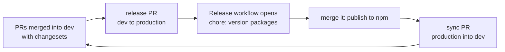

# Contributing to ChatCops

Thanks for helping out. This guide covers setup, how we work, and what a good PR looks like.

## Hacktoberfest 2026

We're taking part in Hacktoberfest this year, and first-time contributors are very welcome.

1. Pick an open issue labeled [`hacktoberfest`](https://github.com/codercops/chatcops/issues?q=is%3Aissue+is%3Aopen+label%3Ahacktoberfest+no%3Aassignee) or [`good first issue`](https://github.com/codercops/chatcops/issues?q=is%3Aissue+is%3Aopen+label%3A%22good+first+issue%22+no%3Aassignee) that nobody is assigned to.
2. Comment on it to ask for it. I'll assign it to you, usually within a day. Please don't start on an issue that's assigned to someone else.
3. Take one issue at a time. Once your PR is merged, grab the next one. After 3 merged PRs with us you can hold two issues at once.
4. If you're assigned and there's no PR or update for 5 days, I'll free the issue up for someone else. Just comment if you need more time.
5. Open your PR against `dev` here in codercops/chatcops and put `Closes #<issue number>` in the description. A PR merged inside your own fork never reaches us, so it doesn't count. A check on the PR ("Claim check") fails if that issue isn't assigned to you. Another one ("Description check") fails while the "How I tested this" or "AI assistance" section of the description is missing or empty.

PRs count for Hacktoberfest once they're merged or labeled `hacktoberfest-accepted`. PRs that aren't linked to an issue, only reformat code, or change things nobody asked for will be closed, and spammy ones get the `spam` label. If you have an idea that isn't an issue yet, open an issue first so we can agree on it before you write code. The full rules are under [Ground rules](#ground-rules) below.

Stuck? Ask on the issue, or in `#oss-help` on our [Discord](https://discord.gg/mpGdJyjaRQ). Questions are welcome. Claims still happen on the issue, so the assignment stays visible to everyone.

## Ground rules

### AI tools

You can use AI tools (Copilot, ChatGPT, Claude, Cursor and so on). Two conditions:

1. Say so in the PR. If a tool wrote or rewrote more than autocomplete-sized pieces, fill in the "AI assistance" line in the PR template: which tool, and what you used it for.
2. You own every line. Run it, test it, and be ready to explain it in review. If you can't explain a change, the PR gets closed.

PRs that are unreviewed AI output (code that doesn't run, invented APIs, a description that doesn't match the diff, unrelated rewrites) are treated as spam.

### Spam

These get closed and labeled `spam`:

- a PR for an issue that isn't assigned to you, or that isn't linked to an issue at all
- formatting, whitespace or typo-only changes nobody asked for
- one fix split into several PRs
- a copy of someone else's PR
- claiming a pile of issues at once, or bulk and automated submissions
- untested generated code

Two spam PRs and you won't be assigned more issues this month, and you're out of the CODERCOPS goodies.

### Reviews

Every PR needs a "How I tested this" line: what you ran or clicked through to check it works.

For a bug fix, check that your new test fails without the fix: undo the change in the source, run the tests, then put it back. A test that passes either way doesn't catch anything.

I review most PRs within a few days. Please don't ping repeatedly or DM maintainers about a review. If three days pass with no reply, one follow-up comment on the PR is fine.

### Goodies

The top 5 contributors this October get a CODERCOPS T-shirt and stickers. You need at least 5 merged PRs labeled `hacktoberfest-accepted` across chatcops, ogcops, toolbelt and discord-bot, merged between Oct 1 and Oct 31 (UTC), and ties go to whoever got there first. To keep it fair:

- only PRs for issues that were assigned to you count
- a fix split into several PRs counts once
- what counts is the maintainers' call, and that call is final

These goodies come from CODERCOPS through our own open source program. They're separate from Hacktoberfest, so anything Hacktoberfest itself gives out is a different thing with its own rules.

## Prerequisites

- **Node.js 22 or newer** (CI runs on 22)
- **pnpm 9.** The easiest way is `corepack enable`, which picks up the version pinned in `package.json`.

This is a pnpm workspace. `npm install` does not work here (it fails on `workspace:*` dependencies).

## Development setup

```bash
# Fork the repo on GitHub, then clone your fork
git clone https://github.com/<your-username>/chatcops.git
cd chatcops

# Add upstream remote
git remote add upstream https://github.com/codercops/chatcops.git

# Install dependencies
pnpm install

# Build all packages (do this before running tests)
pnpm -r build

# Run tests
pnpm test

# Run tests with coverage, as CI does (fails if a package drops below its minimum)
pnpm test:coverage

# Typecheck
pnpm -r typecheck
```

Build before you test. The server tests import `@chatcops/core` from its `dist` folder, so on a fresh clone `pnpm test` fails until you've run `pnpm -r build`. If you change `packages/core`, rebuild it before running the server tests again.

`pnpm -r build` also builds the website. To build only the packages, run `pnpm --filter "./packages/*" build`.

## Project structure

```
packages/
  core/     @chatcops/core (AI providers, tools, knowledge base)
  widget/   @chatcops/widget (embeddable chat UI)
  server/   @chatcops/server (server handler + adapters)
  store-*/  conversation, counter and analytics stores, one package per backend
website/    Marketing site + Starlight docs (Astro)
```

## Development workflow

1. Sync your fork's `dev` branch with upstream:
   ```bash
   git fetch upstream
   git checkout dev
   git merge upstream/dev
   ```
2. Create a branch for your change. Don't work directly on `dev`, or every PR you open will include commits from the others.
   ```bash
   git checkout -b fix/express-cors-example
   ```
3. Run tests: `pnpm test`
4. Run typecheck: `pnpm -r typecheck`
5. Add a changeset if your change affects a published package (`core`, `widget` or `server`): `pnpm changeset`. Docs and website changes don't need one.
6. Push your branch and open a PR against upstream `dev`.

### Branch strategy

- **`dev`** is the default branch. All development happens here.
- **`production`** is the release branch, merged from `dev` when cutting a release.
- PRs should target **`dev`** unless you're doing a production release.

### Releasing to production



1. Every PR to `dev` that changes package source (`packages/*/src`) needs a changeset; the `changeset` check in CI fails without one. Create it with:
   ```bash
   pnpm changeset
   ```
   For a change that shouldn't be released (an internal refactor, for example), use `pnpm changeset --empty`.

2. When `dev` is ready to ship, a maintainer opens a PR from `dev` to `production` and merges it with a merge commit.

3. The **Release** workflow runs on every push to `production`:
   - It builds, typechecks and tests everything.
   - If there are unreleased changesets, the Changesets action opens a **"chore: version packages"** PR on `production` that bumps versions and updates changelogs.
   - Merging that PR runs the workflow again, which **publishes to npm** through OIDC trusted publishing.

4. After a publish, `dev` has to catch up with the version commit on `production`. The workflow opens a **"sync: production into dev"** PR when the release bot is set up (below). Merge it with a merge commit, not a squash. Without the bot, the job summary shows the command to run instead:
   ```bash
   git fetch upstream && git push upstream upstream/production:dev
   ```

5. The website is deployed to Cloudflare Workers by Workers Builds (the `chatcops-website` Worker, config in `website/wrangler.jsonc`). No manual step needed.

> **Note:** Only maintainers can merge into `production`. If you're a contributor, make sure your PR to `dev` includes a changeset when it changes a package.

#### Setting up the release bot (maintainers, once)

The sync PR has to be opened by a GitHub App: `dev` requires CI to pass, and a PR opened with the workflow's own `GITHUB_TOKEN` doesn't trigger CI.

1. In the organization settings, open **Developer settings > GitHub Apps > New GitHub App**. Any name works (ours is `chatcops-release-bot`). Turn off the webhook. GitHub asks you to confirm your identity first.
2. Under **Repository permissions**, give it **Contents: Read and write** and **Pull requests: Read and write**. Nothing else.
3. Create it, then **Install App** on `codercops/chatcops` only.
4. Copy the **App ID** into a repository variable named `RELEASE_BOT_APP_ID` (Settings > Secrets and variables > Actions > Variables).
5. In the app settings, open **Credentials > Key pairs** and click **New key**. GitHub downloads the `.pem` file once. Save it as a repository secret, then delete the file:
   ```bash
   gh secret set RELEASE_BOT_PRIVATE_KEY -R codercops/chatcops < path/to/key.pem
   ```

The next publish opens the sync PR on its own.

## Widget development

```bash
cd packages/widget

# Rebuild the widget on every change
pnpm dev

# In a second terminal, serve the folder
pnpm exec vite
```

Then open `http://localhost:5173/dev.html`. Opening `dev.html` straight from disk doesn't work, because browsers block module scripts on `file://` URLs.

The page starts in popup mode. Open `http://localhost:5173/dev.html?mode=inline` to render the widget inside a 400×600 container instead (any other `mode` value falls back to popup). The links at the top switch modes, and the Open and Close buttons call `ChatCops.open()` and `ChatCops.close()`.

To test with a real backend, build the packages first, then run the Express example:

```bash
pnpm --filter "./packages/*" build
cd packages/server
ANTHROPIC_API_KEY=sk-... npx tsx src/examples/express-server.ts
```

`npx` downloads `tsx` the first time.

The widget has a size budget: 14 kB gzipped for the script tag bundle (`dist/chatcops.min.js`), checked in CI by `pnpm size` after a build (limits in `.size-limit.json`).

### Browser tests

The unit tests run in happy-dom. The tests in `e2e/` load the built widget in a real Chromium and run an axe accessibility check. `e2e/server.mjs` serves the pages and runs the real `@chatcops/server` handler, with a stand-in provider that answers by the message text (no API keys needed). A second, cross-origin server stands in for a 0.5 server:

```bash
pnpm --filter @chatcops/widget --filter "@chatcops/server..." build
pnpm exec playwright install chromium   # once
pnpm e2e
```

They cover starting from the script tag, streaming, Escape and the tab order, the phone layout, accessibility, a reply that fails or is cut off, a slow tool kept alive by pings, session tokens, and a chat API on another origin. CI runs them in the `e2e` job. Add a test there when you change how the widget behaves in a browser.

## Adding a new AI provider

1. Create `packages/core/src/providers/{name}.ts`
2. Implement the `AIProvider` interface
3. Add a format converter in `base.ts`
4. Register in the `createProvider` factory
5. Export from `index.ts`
6. Add tests

## Writing a store package

Stores live in their own packages (`packages/store-<name>`), so a Cloudflare user never installs a Postgres driver. Each one implements the interfaces in `packages/core/src/storage/types.ts`: `conversations` is required, and `counters`, `kv` and `events` are what make rate limits and analytics work across server instances. `memoryStorage()` in `packages/core/src/storage/memory.ts` is the reference.

A new package needs:

- `package.json` with `"private": true` until a maintainer publishes it for the first time, `"type": "module"`, an `exports` entry like `@chatcops/core`'s, `"@chatcops/core": "workspace:^"` in `peerDependencies` (and `"workspace:*"` in `devDependencies`), the database client as a peer dependency where there is one, and the `build`, `typecheck` and `test` scripts.
- `tsconfig.json` extending `../../tsconfig.json`, like the other packages.
- `tests/conformance.test.ts` running the shared suite, which is the contract every store has to meet:

  ```ts
  import { describe } from 'vitest';
  import { runStorageConformance } from '@chatcops/core/testing';
  import { redisStorage } from '../src/index.js';

  const url = process.env.CHATCOPS_TEST_REDIS_URL;
  if (url) runStorageConformance('redis', () => redisStorage({ url }));
  else describe.skip('redis conformance (set CHATCOPS_TEST_REDIS_URL to run)', () => {});
  ```

CI runs Redis, the Upstash REST emulator and Postgres next to the tests and sets `CHATCOPS_TEST_REDIS_URL`, `CHATCOPS_TEST_UPSTASH_URL` with `CHATCOPS_TEST_UPSTASH_TOKEN`, and `CHATCOPS_TEST_POSTGRES_URL` (see `.github/workflows/ci.yml`). Locally, start the same containers with Docker and export the variables, or let those tests skip. The root `vitest.config.ts` and `pnpm publint` pick up a new package by themselves, and store packages need 90% line and 80% branch coverage, checked in CI (locally the database tests skip, so the store floor only applies there).

## Adding a new locale

There are two sets of strings:

- **Core strings** (`packages/core/src/i18n/`):
  1. Create `packages/core/src/i18n/{code}.ts`
  2. Export all `LocaleStrings` fields
  3. Register in `packages/core/src/i18n/index.ts`
  4. Add to the test in `packages/core/tests/i18n/locales.test.ts`
- **Widget UI strings** (`packages/widget/src/i18n.ts`). The widget is a zero-dependency bundle and doesn't import core, so a language has to be added here too before the widget UI shows it.

Use proper accents and native script (for example Devanagari for Hindi).

## Website development

```bash
pnpm --filter "./packages/*" build   # the site imports the built widget
cd website
pnpm dev
```

The site runs without any secrets. Only the live chat demo on the landing page needs `OPENAI_API_KEY`, and most contributors can skip it. If you want the demo or the visitor counter locally, put the values in `website/.dev.vars`:

```bash
OPENAI_API_KEY=sk-...
UPSTASH_REDIS_REST_URL=https://your-endpoint.upstash.io
UPSTASH_REDIS_REST_TOKEN=your-token-here
VISITOR_HASH_SALT=any-long-random-string
```

The visitor counter shows `-` without Upstash credentials, and counts each visitor once per day only when `VISITOR_HASH_SALT` is set. Without it, every call increments the count. Google Analytics (`G-GLYL9J6QYX`) is hardcoded in the layout and Starlight config.

## Commit convention

Use conventional commits: `feat:`, `fix:`, `chore:`, `docs:`, `test:`, `refactor:`
